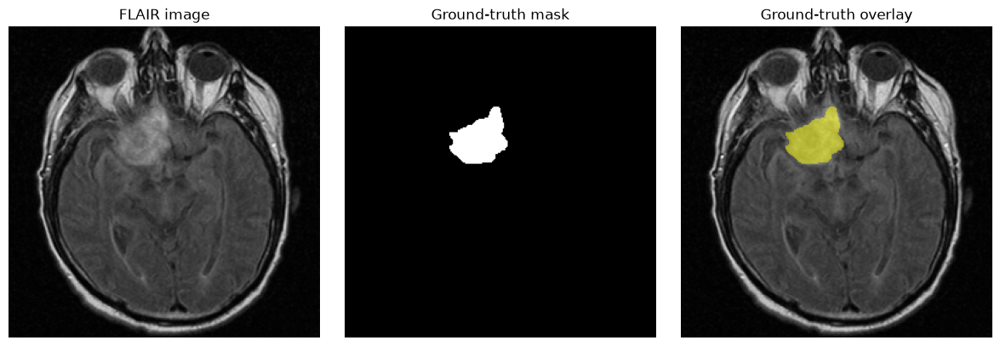
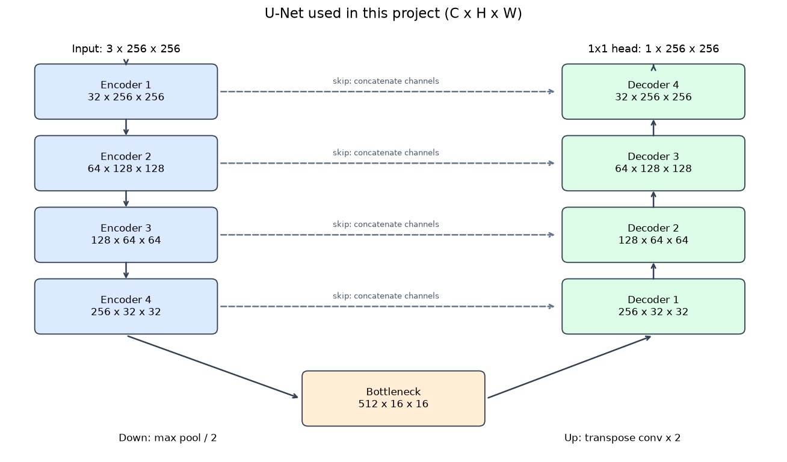
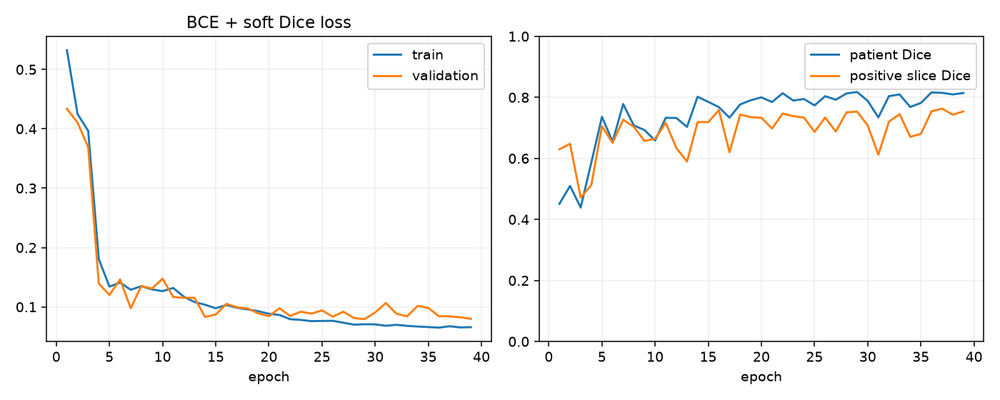
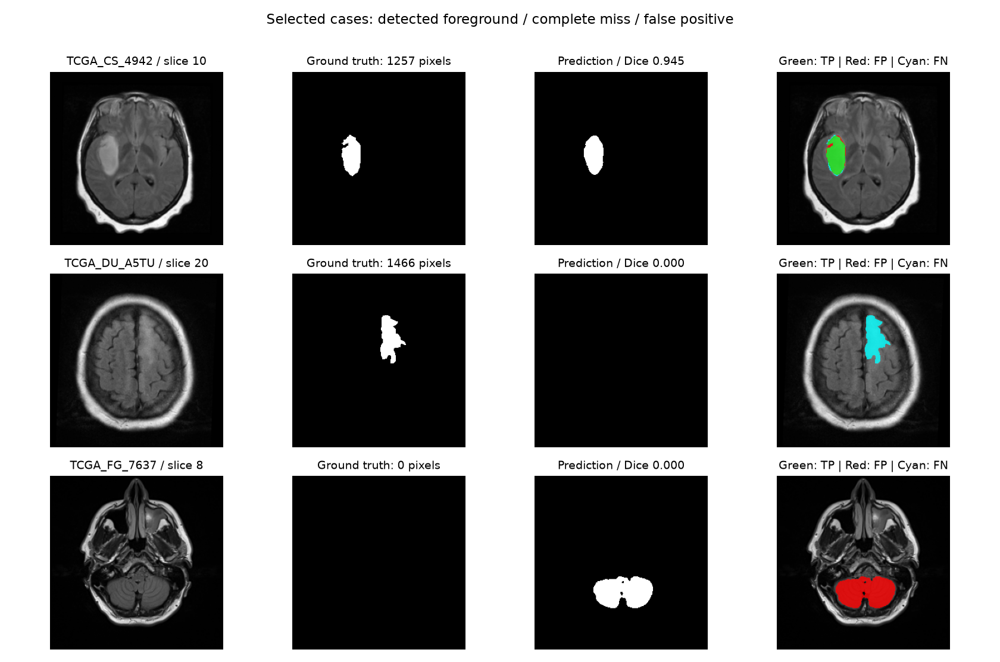

# Brain MRI Segmentation with U-Net

使用 PyTorch 从零训练 **2D U-Net**，对脑 MRI 中的 **FLAIR 异常区域**进行逐像素二分类。项目包含数据检查、患者级划分、训练、测试评估和单张预测。

在 16 位测试患者的 540 张切片上，患者级平均 Dice 为 **0.7749**，含前景切片平均 Dice 为 **0.7592**。

[阅读精简 Notebook](brain_mri_unet.ipynb) · [实验记录](reports/unet256) · [原始数据集](https://www.kaggle.com/datasets/mateuszbuda/lgg-mri-segmentation/data)

## 核心思路

- **先分患者，再分切片**：同一患者只属于一个集合，避免相邻切片跨集合造成数据泄漏。
- **编码器理解区域，解码器恢复位置**：下采样提取上下文，上采样恢复分辨率，跳跃连接补充边界细节。
- **同时关注分类和区域重叠**：使用 BCE + soft Dice 损失，以验证集患者 Dice 选择模型，测试时固定阈值 0.5。

## 数据与预处理

使用 [LGG MRI Segmentation](https://www.kaggle.com/datasets/mateuszbuda/lgg-mri-segmentation/data) 数据集，共 110 位患者、3,929 对 TIFF 图像与掩膜。三通道依次为 pre-contrast、FLAIR、post-contrast，缺失序列由 FLAIR 替代；标签表示 FLAIR 异常区域。下图仅显示 FLAIR 通道，模型输入为三个通道。



固定患者划分种子为 42：

| 集合 | 患者数 | 切片数 | 含前景 | 空掩膜 |
| --- | ---: | ---: | ---: | ---: |
| 训练集 | 78 | 2,845 | 978 | 1,867 |
| 验证集 | 16 | 544 | 203 | 341 |
| 测试集 | 16 | 540 | 192 | 348 |

每张图像的每个通道分别对**非零像素**做 z-score，零背景保持为零：

$$
\widetilde{x}_{c,i} =
\begin{cases}
\dfrac{x_{c,i}-\mu_c}{\max(\sigma_c,10^{-6})}, & x_{c,i}\ne 0,\\
0, & x_{c,i}=0.
\end{cases}
$$

$\mu_c,\sigma_c$ 只使用当前切片该通道的非零像素计算。图像缩放使用双线性插值，掩膜使用最近邻插值；训练集同步随机旋转 90° 的整数倍、水平翻转，验证和测试不增强。掩膜统一转换为 0/1。

训练集前景像素仅约占 **0.98%**，因此保留空掩膜学习背景，并使用 Dice 等重叠指标评估模型。

实现：[datasets/mri.py](datasets/mri.py)。[划分清单](reports/unet256/manifest.json)记录每张切片的归属及源文件 SHA-256 指纹，加载时检查患者重叠、样本完整性和文件变化。

## U-Net 与核心公式

本实现使用四次下采样，基础通道数 32，共 **7,763,041** 个可训练参数；采用同尺寸填充、BatchNorm 和转置卷积上采样。



**卷积块。** 每个块包含两次 $3\times3$ 卷积、BatchNorm 和 ReLU。记 $g_l$ 为第 $l$ 层双卷积块，单次卷积的局部特征计算为：

$$
h_{o,i,j}=\mathrm{ReLU}\left(\mathrm{BN}\left[
\sum_c\sum_{u=-1}^{1}\sum_{v=-1}^{1}W_{o,c,u,v}\,x_{c,i+u,j+v}
\right]\right).
$$

卷积核共享参数，学习局部纹理与边缘；padding=1、stride=1 保持空间尺寸。

**编码器。** 用 $E_l$ 表示第 $l$ 层编码特征：

$$
E_0=g_0(X),\qquad
E_l=g_l\!\left(\mathrm{MaxPool}_{2\times2}(E_{l-1})\right),\quad l=1,\ldots,4.
$$

池化每次将高宽减半，后续卷积增加通道数，使深层特征覆盖更大的输入区域。对于 $256\times256$ 输入，瓶颈层为 $512\times16\times16$。

**解码器与跳跃连接。** 令 $D_4=E_4$：

$$
U_l=\mathrm{ConvTranspose}_{2\times2,\,s=2}(D_{l+1}),
\qquad
D_l=g_l^{\mathrm{dec}}\!\left(\mathrm{Concat}_{C}(E_l,U_l)\right),\quad l=3,2,1,0.
$$

转置卷积学习如何上采样；跳跃连接沿**通道维拼接**对应编码特征，将浅层位置信息送入解码器，双卷积再融合两类特征。例如最后一层将两组 $32\times256\times256$ 拼成 $64\times256\times256$，再输出 32 通道。

**输出。** $1\times1$ 卷积映射为单通道 logits，sigmoid 转成前景概率：

$$
z=\mathrm{Conv}_{1\times1}(D_0),\qquad
p_i=\sigma(z_i)=\frac{1}{1+e^{-z_i}},\qquad
\widehat{y}_i=\mathbf{1}[p_i\ge0.5].
$$

实现：[models/unet.py](models/unet.py)。结构思路参考 [U-Net 原论文](https://arxiv.org/abs/1505.04597)。

## 损失函数与训练

记批次大小为 $B$，每张切片有 $N$ 个像素，标签为 $y_{b,i}\in\{0,1\}$。**BCE** 约束逐像素分类：

$$
\mathcal{L}_{\mathrm{BCE}}=-\frac{1}{BN}\sum_{b=1}^{B}\sum_{i=1}^{N}
\left[y_{b,i}\log p_{b,i}+(1-y_{b,i})\log(1-p_{b,i})\right].
$$

**Soft Dice** 约束前景重叠，先逐切片计算，再对批次求平均：

$$
d_b=\frac{2\sum_i p_{b,i}y_{b,i}+1}{\sum_i p_{b,i}+\sum_i y_{b,i}+1},
\qquad
\mathcal{L}=\frac{1}{2}\mathcal{L}_{\mathrm{BCE}}
+\frac{1}{2}\left(1-\frac{1}{B}\sum_{b=1}^{B}d_b\right).
$$

平滑项取 1。代码使用 `BCEWithLogitsLoss` 对应的函数直接接收 logits，以提高数值稳定性；sigmoid 仅用于 soft Dice 和预测。实现：[training/losses.py](training/losses.py)。

| 设置 | 本次实验 |
| --- | --- |
| 输入 / 基础通道 / batch size | 256×256 / 32 / 8 |
| 优化器 | AdamW，学习率 0.001，weight decay 0.0001 |
| 学习率调度 | ReduceLROnPlateau，监控验证患者 Dice，patience=4，factor=0.5 |
| 训练预算 / 早停 patience | 最多 40 轮 / 10 |
| 训练种子 | 42 |
| 选模依据 | 验证集患者级平均 Dice 最大 |
| 实际训练 | 第 39 轮早停；最佳第 29 轮，验证患者 Dice 0.8177 |

CUDA 下启用混合精度，并将梯度范数裁剪到 1。固定种子便于复现，硬件和依赖差异仍可能带来数值差异。



## 测试结果与错误案例

测试使用第 29 轮权重、训练时固定的患者划分和阈值 0.5；指标在 $256\times256$ 尺寸上计算。设预测前景集合为 $P$，真实前景为 $G$：

$$
\mathrm{Dice}=\frac{2|P\cap G|}{|P|+|G|},
\qquad
\mathrm{IoU}=\frac{|P\cap G|}{|P\cup G|}.
$$

硬指标不加平滑项；预测和真实掩膜都为空时记为 1。患者级 Dice 先累加同一患者所有切片的像素计数，再对患者等权平均：

$$
\mathrm{Dice}_{\mathrm{patient}}=\frac{1}{K}\sum_{k=1}^{K}
\frac{2\sum_{s\in S_k}|P_s\cap G_s|}
{\sum_{s\in S_k}|P_s|+\sum_{s\in S_k}|G_s|}.
$$

$K$ 为患者数，$S_k$ 为第 $k$ 位患者的全部切片；分母为零时同样记为 1。

| 测试指标 | 结果 |
| --- | ---: |
| **患者级平均 Dice** | **0.7749** |
| 含前景切片平均 Dice | 0.7592 |
| 全部切片平均 Dice | 0.8792 |
| 全部切片平均 IoU | 0.8457 |
| 空掩膜切片出现任意假阳性 | 19 / 348（5.46%） |
| 含前景切片被完全预测为空 | 16 / 192（8.33%） |

全部切片指标是逐切片分数的平均值。测试集中空掩膜较多，因此同时报告患者 Dice、含前景 Dice 和空掩膜误检比例，避免只用 0.8792 概括分割效果。



从左到右为 FLAIR、真实掩膜、预测掩膜和误差叠加；**绿色**为正确前景，**红色**为误检，**青色**为漏检。三行是有意选择的正确检出、完全漏检及空掩膜误检案例，用于解释模型行为，不代表随机抽样的平均表现。

原始记录：[汇总指标](reports/unet256/test_metrics.json)、[逐患者指标](reports/unet256/test_patients.json)、[逐切片指标](reports/unet256/test_slices.json)、[训练历史](reports/unet256/history.json)。

本实验仍有完整漏检和明显误检；模型只使用单张 2D 切片，且只在一次患者划分上验证。后续可在训练/验证集上研究跨切片信息、损失权重和增强策略，并通过患者级交叉验证评估稳定性。

## 运行与复现

### 1. 安装环境

在 Python 3.11 环境中执行：

```bash
git clone https://github.com/peanutsanya09-maker/brain-mri-unet.git
cd brain-mri-unet
python -m pip install -r requirements.txt
python main.py check-env
```

后续命令均在项目根目录运行。依赖版本固定在 [requirements.txt](requirements.txt)。本次实验环境为 Python 3.11.17、PyTorch 2.11.0+cu128、RTX 5070 Ti Laptop GPU。CUDA 环境请先按 [PyTorch 安装说明](https://pytorch.org/get-started/locally/)选择对应构建，再安装其他依赖；无 CUDA 时自动使用 CPU，也可传入 `--device cpu`。

### 2. 放置数据并生成划分

从原始数据集页面下载，或使用相同内容的 Hugging Face 镜像，解压后保留 TIFF 图像和对应 `_mask.tif`：

```text
data/kaggle_3m/
└── TCGA_CS_4941_19960909/
    ├── TCGA_CS_4941_19960909_1.tif
    ├── TCGA_CS_4941_19960909_1_mask.tif
    └── ...
```

```bash
python main.py check-data --data data/kaggle_3m
python main.py prepare --data data/kaggle_3m --seed 42 --output outputs/prepare
```

`--data` 应指向**单份**数据根目录；重复拷贝会被拒绝。`prepare` 检查全部配对、尺寸和掩膜，生成划分清单、统计和预览。已有 `manifest.json` 时直接复用，或换一个输出目录。

仓库保存了本次实验的 [manifest](reports/unet256/manifest.json)。要严格沿用同一划分，可把下面训练命令中的 `--manifest` 改为 `reports/unet256/manifest.json`；加载时会核对源文件指纹。

### 3. 训练与评估

```bash
python main.py train --data data/kaggle_3m --manifest outputs/prepare/manifest.json --seed 42 --size 256 --base 32 --batch-size 8 --epochs 40 --patience 10 --output outputs/unet256
python main.py evaluate --data data/kaggle_3m --manifest outputs/unet256/manifest.json --checkpoint outputs/unet256/best.pt --split test --output outputs/unet256/evaluation
```

训练保存 `best.pt`、`last.pt`、配置、划分和曲线；评估保存汇总/逐患者/逐切片 JSON，以及抽样预测图和错误案例图。`prepare --seed` 控制患者划分，`train --seed` 控制初始化、打乱和增强。

训练不会覆盖已有实验；再次训练需使用新的 `--output`。可先用 `--epochs 1 --max-batches 2 --output outputs/smoke` 检查流程；这种检查权重只能用于验证集，不能进行正式测试集评估。

### 4. 单张预测

```bash
python main.py predict --checkpoint outputs/unet256/best.pt --image data/kaggle_3m/TCGA_CS_4941_19960909/TCGA_CS_4941_19960909_1.tif --output outputs/prediction
```

输入三通道 TIFF，保存原图尺寸的概率数组、二值掩膜和 FLAIR 叠加图；可用 `--image` 替换成其他切片。

### 5. Notebook 与检查

```bash
python -m pip install -r requirements-notebook.txt
python -m unittest discover -s tests -v
```

用 VS Code 的 Jupyter 支持打开 [brain_mri_unet.ipynb](brain_mri_unet.ipynb)，选择上述 Python 环境，在项目根目录运行。

**Notebook 的图文和已保存结果可直接阅读；执行代码需先完成 CLI 训练**，生成 `outputs/unet256/config.json`、`manifest.json` 和 `best.pt`。其中可选训练单元用于追加实验，不负责首次环境与数据准备。文中的图片与结果是本次实验快照，新实验产物保存到自己的输出目录。

## 仓库结构

| 路径 | 内容 |
| --- | --- |
| [main.py](main.py) | 数据准备、训练、评估、预测的统一入口 |
| [datasets/](datasets) | 数据读取、非零归一化、同步增强、患者划分 |
| [models/unet.py](models/unet.py) | U-Net 编码器、解码器和跳跃连接 |
| [training/](training) | 损失、指标、训练循环与推理 |
| [utils/](utils) | 环境检查、JSON 保存和必要绘图 |
| [tests/test_pipeline.py](tests/test_pipeline.py) | 11 项关键流程测试 |
| [brain_mri_unet.ipynb](brain_mri_unet.ipynb) | 精简说明、核心代码与结果展示 |
| [docs/assets/](docs/assets) | README 的 4 张核心图片 |
| [reports/unet256/](reports/unet256) | 本次实验配置、划分与评估记录 |

Git 仓库保留源码、Notebook 和展示材料；原始数据、模型权重、运行缓存及本机 IDE 配置由 `.gitignore` 排除。**仓库未分发训练权重**，复现时按上面的命令训练生成。

## 参考

- Ronneberger et al. [U-Net: Convolutional Networks for Biomedical Image Segmentation](https://arxiv.org/abs/1505.04597), 2015.
- Mateusz Buda. [Brain MRI segmentation — LGG MRI 数据集](https://www.kaggle.com/datasets/mateuszbuda/lgg-mri-segmentation/data)。示例 MRI 与掩膜来源于该数据集，模型结构图、训练曲线与预测对比由本项目生成。
